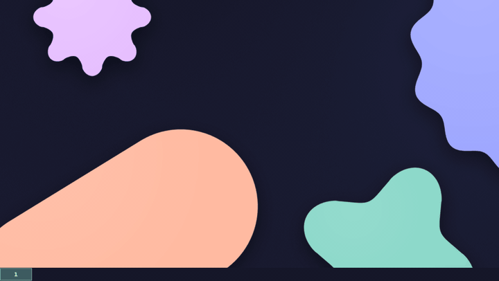

# Wallpaper Parallax for i3

Обои плавно прокручиваются по горизонтали при смене рабочего стола i3, как домашний экран старого Android. Пружина подхватывает текущую скорость при быстрой смене стола, а передний план движется быстрее заднего. Живые сцены могут продолжать движение на неподвижном рабочем столе.



[Скриншот рабочего стола](docs/demo.png) · [Настройки Material You](docs/settings.png) · [Генератор Wallpaper-MY с GIF живой сцены](https://github.com/Kostr2007/Wallpaper-MY)

## Быстрый запуск

В открытой сессии i3 на X11:

```sh
nix run github:Kostr2007/Wallpaper-Parallax-i3/v0.4.0 -- --image "$HOME/Pictures/wallpaper.jpg" --motion spring
```

Или установите команду из исходников в виртуальное окружение:

```sh
python3 -m venv .venv
. .venv/bin/activate
pip install .
wallpaper-parallax --image "$HOME/Pictures/wallpaper.jpg"
```

Для автоматического запуска добавьте в конфиг i3, указав свои абсолютные пути:

```i3
exec --no-startup-id /path/to/wallpaper-parallax --image /path/to/wallpaper.jpg
```

## Настройка

| Параметр | По умолчанию | Что меняет |
| --- | --- | --- |
| `--pages` | 5 | Сколько столов с номерами 1…N распределено по ширине панорамы |
| `--travel` | 20 | Полный ход камеры в процентах от ширины монитора |
| `--duration` | 320 | Длительность плавного перехода или темп пружины. При `0` положение меняется сразу |
| `--motion` | `smooth` | Плавный `smooth`, пружинный `spring` или мгновенный `instant` переход |
| `--inertia` | 55 | Сила отскока пружины от 0 до 100 |
| `--depth` | 70 | Разница в движении слоёв от 0 до 100. При `0` используется плоское изображение |
| `--fps` | 60 | Верхняя граница частоты кадров |
| `--no-ambient` | выключен | Останавливает движение внутри сцены. Переходы между столами работают по настройке `--motion` |
| `--workspace NAME` | — | Имена столов по порядку, один флаг на имя. Используется вместо `--pages` |

Например, пружинный переход для десяти рабочих столов с ходом 36%:

```sh
wallpaper-parallax --image "$HOME/Pictures/wallpaper.jpg" --pages 10 --travel 36 --duration 340 --motion spring
```

Столы с номерами выше `--pages` показывают правый край. Столы без номера показывают центр, если их порядок не задан через `--workspace`. Картинка масштабируется до размера экрана с запасом на прокрутку. Чем больше `--travel`, тем заметнее эффект и тем сильнее приближение у картинки с пропорциями экрана.

### Обои с глубиной

Рядом с плоской картинкой разместите одноимённую папку с суффиксом `.parallax`.

```text
midnight.png
midnight.parallax/
  background.png
  middle.png
  foreground.png
```

Все изображения используют один холст и имеют одинаковые размеры. Фон непрозрачный. Средний и передний планы поддерживают прозрачность PNG. Достаточно одного из этих двух планов. Плоский кадр используется для статичных обоев и для расчёта палитры Material You.

Для просмотра примера клонируйте репозиторий и запустите:

```sh
nix run . -- --image docs/midnight.png --motion spring --travel 45
```

В интеграции с Material You параметры находятся в **Super+I → Обои и стиль → Параллакс обоев**. Выбор перехода, инерция и глубина применяются во время работы. Общий переключатель анимаций в разделе «Интерфейс» включает мгновенное смещение, когда анимации выключены.

### Живые сцены

Каждая сцена содержит плоский PNG и папку `.parallax` рядом с ним. Файлы `background.png`, `atmosphere.png`, `middle.png`, `surface.png`, `foreground.png` и `particles.png` перечислены от дальнего плана к ближнему. Нужен фон и хотя бы один прозрачный слой. Набор можно создать в [Wallpaper-MY](https://github.com/Kostr2007/Wallpaper-MY).

Wallpaper-MY 0.2 экспортирует кадры эффектов в PNG с прозрачностью. Манифест `motion.json` задаёт длину цикла, количество кадров и параметры дорожек.

```json
{
  "version": 2,
  "period": 7.5,
  "frames": 120,
  "tracks": {
    "atmosphere": {"width": 536, "height": 201, "columns": 7}
  }
}
```

Каждая дорожка использует одноимённый файл, здесь `atmosphere.loop.png`. Кадры записаны слева направо и сверху вниз. Вокруг каждого кадра есть граница в один пиксель, повторяющая края кадра для билинейного масштабирования. Полная ширина PNG равна `columns × (width + 2)`, высота равна `ceil(frames / columns) × (height + 2)`. Допустимо 2–144 кадра при частоте до 24 кадров в секунду. При выключении эффектов используется обычный `atmosphere.png`.

Манифест версии 1 задаёт движение слоёв по горизонтали и вертикали.

```json
{
  "version": 1,
  "period": 12,
  "layers": {
    "atmosphere": [4.8, 2.8, 0],
    "particles": [3.2, 4.1, 0.5]
  }
}
```

`period` принимает 2–120 секунд. Для каждого движущегося слоя укажите амплитуды X и Y в процентах от ширины и высоты экрана (0–5) и фазу в долях оборота (0–1). Для X применяется синус, для Y — косинус. Слой без записи сохраняет обычный параллакс при перелистывании. Служба перечитывает манифест вместе с изображениями и использует обычный параллакс при ошибке в манифесте.

Движение на месте ограничено 24 кадрами в секунду. Оно останавливается при нулевой глубине и когда X11 сообщает, что фон полностью закрыт. В Material You им управляют переключатель «Живые обои» и общий переключатель анимаций.

### Подключение к менеджеру обоев

Вместо `--image` передайте `--state-file /path/to/wallpaper.json`. Менеджер обоев может обновлять файл атомарной заменой:

```json
{
  "image": "/home/alex/Pictures/wallpaper.jpg",
  "fit": "fill",
  "motion": "spring",
  "inertia": 55,
  "depth": 70,
  "ambient": true,
  "duration_scale": 1
}
```

`image` — абсолютный путь. `fit` по умолчанию равен `fill`. При значениях `center`, `max` и `tile` служба освобождает фон для основного менеджера обоев. Дополнительные параметры переопределяют параметры запуска. `duration_scale` принимает значения от 0,5 до 2. `ambient: false` ставит движение внутри сцены на паузу, в том числе с пружинным переходом между столами. С флагом `--no-ambient` движение внутри сцены всегда выключено. Изменения файла подхватываются в течение примерно полусекунды.

### Home Manager

Добавьте в inputs своего flake:

```nix
wallpaper-parallax = {
  url = "github:Kostr2007/Wallpaper-Parallax-i3/v0.4.0";
  inputs.nixpkgs.follows = "nixpkgs";
};
```

В конфигурации пользователя Home Manager:

```nix
{
  imports = [ inputs.wallpaper-parallax.homeManagerModules.default ];
  services.wallpaper-parallax = {
    enable = true;
    image = "/home/alex/Pictures/wallpaper.jpg";
    pages = 5;
    travel = 20;
    motion = "spring";
    inertia = 55;
    depth = 70;
  };
}
```

Служба по умолчанию запускается через `i3-session.target`. Для Xsession, которой управляет Home Manager, задайте `sessionTarget = "graphical-session.target";`. В качестве источника можно задать `stateFile` вместо `image`.

## Совместимость и проверка

- Требуется i3 на X11 с 24-битным TrueColor. Поддерживаются PNG, JPEG, WebP и другие форматы Pillow. Для JPEG XL используется `djxl` из libjxl, который включён в пакет Nix.
- Изображение загружается в X11 при смене картинки или размера экрана. Сервер X11 сдвигает области отрисовки, а XRender смешивает слои с прозрачностью. У каждого выхода своя позиция.
- Поддерживается picom. Служба рисует на прозрачном для ввода слое под окнами, поэтому после её остановки видны статичные обои X11.
- `nix flake check` запускает i3 на Xvfb и проверяет пружину, два монитора, прозрачность, движение старых сцен, смену кадров новых эффектов на неподвижном столе и статичный кадр при отключении.

Демонстрацию можно переснять командой `tools/record-demo.sh docs/midnight.png docs`. Для живой сцены добавьте `--live`, чтобы первые четыре секунды показать один рабочий стол. Нужны Xvfb, i3, picom, xwininfo, ffmpeg с `x11grab` и установленная команда `wallpaper-parallax`.

[Android WallpaperService.Engine](https://developer.android.com/reference/android/service/wallpaper/WallpaperService.Engine) · [Пружины Material 3](https://github.com/material-components/material-components-android/blob/master/docs/theming/Motion.md) · [Протокол i3 IPC](https://i3wm.org/docs/ipc.html)
